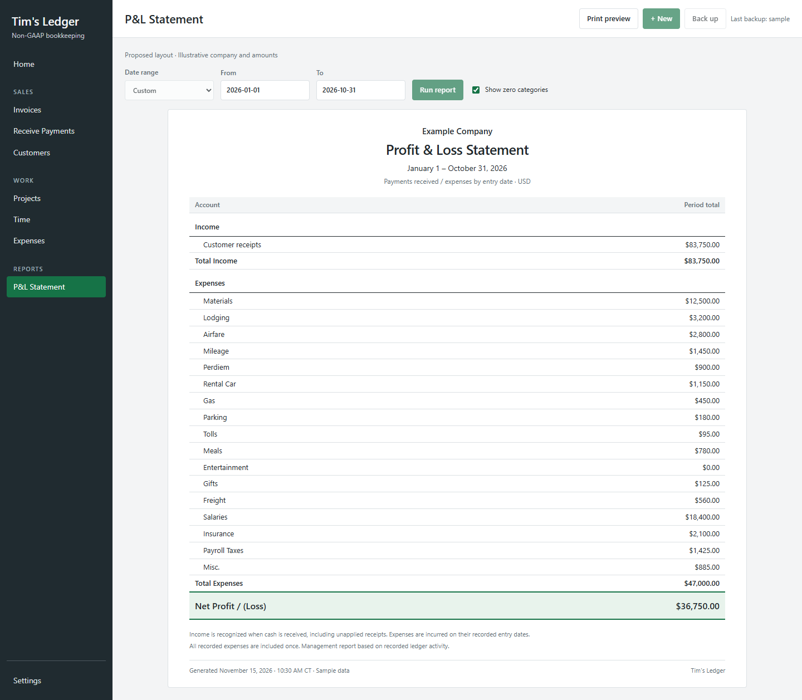
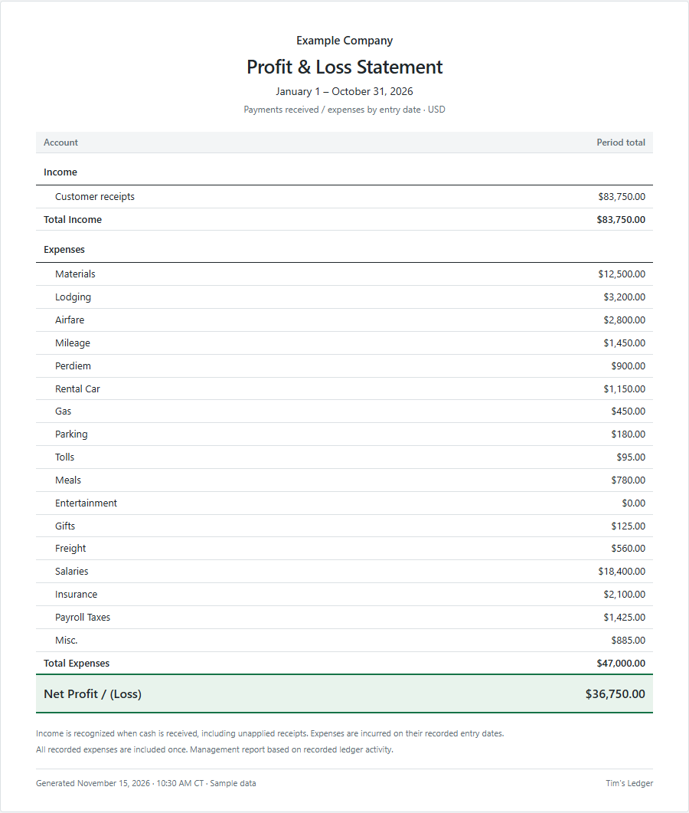

# P&L Statement Plan

Date: November 15, 2026

Status: Proposed implementation. Confirmed rules: income occurs when cash is received; expenses are incurred on their recorded entry dates. Year-end closing is a separate planning item. Application behavior has not been changed.

Add a read-only **P&L Statement** under a new **REPORTS** sidebar heading. The report will show payments received, expenses by their recorded entry dates, and the resulting net profit or loss for a selected period. Users can review the statement and print it or save it as a PDF through the browser.

## 1 Scope and accounting basis

The first release is a company-wide management report using existing ledger records. It needs no new financial entry workflow or database fields.

| Decision | First release |
| --- | --- |
| Income | Saved net payment amounts dated within the selected period, including unapplied receipts. Show one Customer receipts line. |
| Expenses | Expenses are incurred on the date recorded on the expense entry (`entry_date`). Include billable, non-billable, invoiced, and unbilled expense line totals in the selected period. |
| Result | Total Income minus Total Expenses. |
| Basis label | `Payments received / expenses by entry date`. Show this on screen and in print. |
| Scope | All customers and projects, including internal projects. |
| Expense grouping | Existing expense categories in their established order. |
| Interaction | Read-only report; date and display controls stay browser-local. |
| Delivery | On-screen statement and browser printing / Save as PDF. |

Payment dates provide a receipt date. Expense records provide `entry_date`, but have no paid date or paid status. Therefore, the report cannot verify cash-basis expense timing. Calling it simply “Cash basis” would hide that limitation. Cash accounting generally recognizes receipts when received and expenses when paid; accrual accounting uses earned income and incurred expenses. [IRS Publication 538](https://www.irs.gov/publications/p538) explains this distinction.

The report includes only activity recorded in Tim's Ledger. It does not calculate tax deductions, depreciation, inventory adjustments, or unrecorded payroll and other costs. Existing categories such as Meals and Entertainment remain their full recorded amounts; the application does not apply deductibility percentages.

### Income rules

1. Sum `payments.amount_cents` using `payments.payment_date`, with both selected boundary dates included.
2. Show one **Customer receipts** line equal to the sum of saved payment amounts, followed by **Total Income**. Reflect existing corrections in that net amount; do not add a separate negative-payment line or a new refund workflow. Retain signed arithmetic for any supported negative ledger records. Zero-dollar saved payments contribute zero.
3. Count the whole receipt once, whether fully applied, partly applied, or unapplied. A split across several invoices must not multiply income.
4. A receipt for a prior-period invoice belongs to the receipt's payment period. Applying a receipt in a later period does not create new income or move the receipt date.
5. Draft or issued invoices, open A/R, source time charges, and expense reimbursements are not added separately to payments. Payments already represent the money received.
6. For an open year, the report follows saved payment corrections: editing a receipt to its net amount changes the report for its payment date. The report does not reconstruct immutable historical balances. Do not edit a receipt in a closed year to record a later correction; the correction/reopening procedure belongs to the separate year-end close plan.

### Expense rules

1. Sum stored `expenses.line_total_cents` using `expenses.entry_date`, with both selected boundary dates included.
2. Include every saved expense once, regardless of `is_billable` or `invoice_id`. Non-billable expenses are a subset of total expenses, not another deduction.
3. Use the stored rounded cent total. Do not recalculate quantity times unit cost in the report or round aggregate fractional unit costs again.
4. Include materials costs recorded as non-billable expenses even when the related sale is represented by custom project rates and time units.
5. Time entries represent charges to customers. They do not establish the business's payroll cost and must not be treated as an expense. Salaries appear only when recorded as expenses.
6. Preserve the exact category list: Materials, Lodging, Airfare, Mileage, Perdiem, Rental Car, Gas, Parking, Tolls, Meals, Entertainment, Gifts, Freight, Salaries, Insurance, Payroll Taxes, Misc.
7. If legacy or directly imported data contains a category outside that list, include it visibly as `Unrecognized category: {stored value}` after the standard categories and flag it in the report. An empty category appears as `Uncategorized`. Do not omit its cost or rewrite the record.

### Classification limits

The billable flag controls invoice eligibility. It does not identify cost of goods sold versus overhead. Materials, salaries, and non-billable costs can serve different purposes, so the first release shows one Expenses section and no Gross Profit subtotal. A later cost-of-sales split needs an explicit classification rule or data field.

Payment records belong to customers, not projects, and unapplied money has no invoice/project assignment. Keep the initial P&L company-wide and show one receipt income stream. Customer/project profitability, service-versus-materials income, and allocation-based revenue splits are separate work.

### Year-end payments and customer credit

Receipt timing governs income even when invoice and application dates cross a year boundary. Do not cap income at the amount invoiced during the period.

| Situation | P&L treatment | Customer account treatment |
| --- | --- | --- |
| December 2026 invoice paid in January 2027 | Income in 2027. | Invoice carries forward open until paid. |
| December 2026 receipt allocated to an invoice in January 2027 | Income in 2026; allocation creates no additional income. | Allocation reduces the invoice balance. |
| $1,200 received against a $1,000 invoice in December 2026 | Entire $1,200 is income in 2026. | $1,000 applied and $200 retained as customer credit. |
| The $200 credit is applied to a new invoice in 2027 | No additional income in 2027. | Credit and invoice open balance decrease together. |

Unpaid invoices and unapplied customer credits remain in the same continuous ledger across December 31. Do not clear them, create duplicate receipts, or move their dates into the new year.

### Closed-year guidance and separate work

Include this guidance in P&L help and the workflow documentation:

> After a year is closed, do not edit, delete, or change the dates or amounts of that year's financial records. Use the year-end close procedure to resolve corrections. Continue recording new-year receipts and applying existing customer credit through the ordinary payment workflow.

Changing allocations in the new year is permitted when it leaves closed-year receipt amounts/dates and invoice charges unchanged. Current invoice balances and statuses may change as later payments arrive; this does not recognize that income again or rewrite the prior-year P&L.

Closing a year is an explicit procedure, not an automatic December 31 reset. Plan it separately in [Year End Close Plan](Year%20End%20Close%20Plan.md), including final review, backup and retained reports, correction policy, and the decision about software enforcement. The P&L release provides guidance only: it does not mark years closed, add a closing lock, create an as-of allocation history, or perform a close. Its report can change if users edit underlying saved records despite that guidance.

## 2 Navigation and page registration

Place REPORTS after WORK. Settings stays anchored at the bottom of the sidebar.

```text
Home

SALES
  Invoices
  Receive Payments
  Customers

WORK
  Projects
  Time
  Expenses

REPORTS
  P&L Statement

Settings
```

In `backend/app/pages.py`, add `profit-loss.html` immediately after `expenses.html` and before `company.html`:

| Page property | Value |
| --- | --- |
| `filename` | `profit-loss.html` |
| `title` | `Tim's Ledger P&L Statement` |
| `label` and `heading` | `P&L Statement` |
| `group` | `Reports` |
| `script_url` | `/frontend/js/profit-loss.js` with the repository's version query convention |
| `new_label` | `None` |
| `supports_edit_mode` | `False` |
| `is_settings` | `False` |
| `help_text` | Explain receipt income, expense entry dates, inclusive date range, recorded-data scope, and the instruction against editing closed years. |

The shared template already emits uppercase group headings and active links from the registry. Use it to render REPORTS and `aria-current="page"`; no browser-side navigation logic or broad template static mount is needed. The new page route is `/frontend/html/profit-loss.html`.

The P&L header retains contextual help, the existing global + New menu, Back up, and the last-backup indicator. Add the report's Print / Save PDF page action. The P&L itself has no Edit Mode button, Save action, or new-record item in + New.

## 3 Report layout

The mockups use illustrative company details and amounts, not the production database.



The report is the main content surface. Keep a compact date toolbar above it and avoid duplicating its totals in metric cards. Match the existing Segoe UI typography, dark sidebar, green active navigation, restrained borders, and dense desktop spacing.

1. **Toolbar:** Date range preset, From, To, Run report, and Show zero categories.
2. **Report heading:** Company name from Settings, Profit & Loss Statement, inclusive period, accounting basis, and USD.
3. **Statement table:** Account label on the left; Period total aligned on the right with two decimal places and tabular figures.
4. **Income:** One Customer receipts line using net saved amounts and emphasized Total Income. No separate negative-payment line.
5. **Expenses:** One line per established category, followed by emphasized Total Expenses.
6. **Result:** A distinct final row labeled Net Profit / (Loss). Use parentheses for negative amounts and `$0.00` for zero; avoid negative zero.
7. **Footer:** Basis explanation, inclusion of unapplied receipts and all recorded expenses, generated date/time with timezone, and any unrecognized-category warning.

Show zero categories by default. Hiding them changes display only; Income, Expenses, their totals, and the result remain visible even when zero. Preserve negative values without relying on red color to convey their sign.

The sample reconciles as follows: Customer receipts and Total Income are $83,750.00. The 17 category amounts total $47,000.00. Net Profit / (Loss) is $36,750.00.

### Date controls

| Preset | Inclusive range |
| --- | --- |
| Year to date, default | January 1 of the browser's current local year through today. |
| This month | First day of the current month through today. |
| Last month | First through last day of the previous calendar month. |
| Last year | January 1 through December 31 of the previous calendar year. |
| Custom | User-supplied From and To dates. |
| All dates | No date restriction on either payments or expenses. |

Use local calendar components rather than slicing a UTC timestamp to determine today. Presets fill browser-local draft dates. Editing either date changes the preset to Custom. Run report submits the dates; opening the page runs Year to date once.

Require valid ISO calendar dates and From less than or equal to To. Future dates are allowed if explicitly selected; include future-dated saved records that fall inside the requested range. All dates is an explicit mode with blank/disabled date controls, not a huge fabricated date interval. Its report heading reads All recorded dates.

Keep draft filters separate from the filters attached to the displayed result. While they differ, show `Filters changed — run report to update` and disable Print / Save PDF. After success, label the statement with the applied range returned by the backend. Show zero categories remains a local presentation choice and does not require another query.

### Loading, empty, and error states

  - Initial load: show Loading statement and disable printing. Do not show a temporary zero report that looks final.
  - Refresh: retain the previous successful result, mark it Updating, and disable printing until the newest request succeeds.
  - Empty period: show the full zero statement and `No payments or expenses recorded for this period`.
  - Income only: show zero expenses and a positive or negative result based on signed receipts.
  - Expenses only: show zero income and the resulting loss.
  - Invalid filters: show a field-level message before requesting; retain the last valid result.
  - Request failure: retain the last successful result with an explicit not-updated message; retain the draft dates for retry. Keep printing disabled until a successful run matches the current filters.
  - Overlapping requests: abort the older request or ignore its response using a request sequence token. Older data must never replace the latest requested period.

## 4 Backend design and API contract

Add report-building functions to `backend/app/reporting.py` and expose one read-only route in `backend/app/main.py`. Follow the existing SQLite connection and JSON envelope conventions.

### Proposed endpoint

```text
GET /api/reports/profit-loss?date_from=2026-01-01&date_to=2026-10-31
GET /api/reports/profit-loss?all_dates=true
```

For a dated report, both dates are required. Omitting them, supplying only one, using invalid dates, reversing the range, or combining date parameters with `all_dates=true` returns HTTP 422. The frontend sends explicit dates for presets so it controls the local-calendar definition of today. No customer, project, or accounting-basis query parameter is part of this endpoint.

Return `response_envelope(payload, screen="profit_loss")`. Inside `data`, use this proposed shape:

```json
{
  "company": { "company_name": "Example Company" },
  "period": {
    "all_dates": false,
    "date_from": "2026-01-01",
    "date_to": "2026-10-31"
  },
  "basis": {
    "income": "payments_received",
    "expenses": "entry_date",
    "label": "Payments received / expenses by entry date"
  },
  "currency": "USD",
  "income": {
    "customer_receipts_cents": 8375000,
    "total_income_cents": 8375000,
    "payment_count": 42
  },
  "expense_categories": [
    { "category": "Materials", "amount_cents": 1250000, "expense_count": 8 }
  ],
  "total_expenses_cents": 4700000,
  "net_profit_loss_cents": 3675000,
  "expense_count": 67,
  "warnings": [],
  "generated_at": "2026-11-15T16:30:00Z"
}
```

The category array above is abbreviated for illustration. A real response contains all 17 standard categories, including zero categories, followed by any unrecognized categories. Counts describe matching saved records, including zero-value records. In All dates mode the two date values are `null`. `warnings` is an array of displayable strings; return an empty array in the normal case. Generate the timestamp with the existing UTC helper, then format it for local display with an explicit timezone.

### Query and calculation requirements

1. Aggregate signed saved payment amounts directly from `payments` into one net Customer receipts amount. Do not split positive/negative amounts into report lines. Do not join to `payment_applications`, invoices, or invoice source rows when calculating income.
2. Aggregate expenses directly from `expenses`, grouped by category. Do not restrict billability, customer, project, or invoice state.
3. Apply parameterized `>=` and `<=` filters to the stored ISO date columns. In All dates mode omit those predicates.
4. Reuse `EXPENSE_CATEGORIES` as the ordering/zero-fill source; do not duplicate its list in the controller. Resolve the company profile through the existing company helper.
5. Use integer cents throughout, normalize empty sums to zero, and derive totals from the same aggregates used for the visible lines.
6. Build company, income, and expense data from one explicit SQLite read transaction so concurrent edits cannot mix different database snapshots within a report. Finish the read transaction when the payload is built.
7. Keep the report helper free of record mutations, schema writes, and document writes. Do not persist report snapshots in `app-data/invoices/`.
8. Do not reuse the all-record business summary as the dated report calculation: it deliberately has no period filtering. In All dates mode, reconcile Total Income and Total Expenses to that existing summary.

No schema migration is required for the first release. Existing indexes begin with customer/project IDs, so measure representative date-range queries before deciding whether date-only indexes are useful. If needed, add them through a new ordered migration; do not modify applied migrations or create indexes during a report GET. Do not add indexes without evidence of a query problem.

## 5 Frontend implementation

Add `frontend/templates/profit-loss.html`, extending `base.html`, and `frontend/js/profit-loss.js` for page-local state and API access.

Suggested controller state:

```text
draftFilters: preset, dateFrom, dateTo, allDates
appliedReport: last successful response, including applied period
showZeroCategories: true
isLoading: true
requestSequence / abortController
error: null
```

Keep rendering functions separate for the toolbar, statement, warnings, and request status. Use `textContent` for company name, totals, dates, and status text. If building category rows with HTML, escape category names and all other database-derived text with `escapeHtml`. Use semantic table headings and keyboard-accessible controls; announce loading/errors without moving focus unnecessarily.

The report uses the existing 1024px minimum desktop shell. At that width, wrap toolbar fields as needed while keeping the sidebar beside the report. The standalone conversation preview may reflow on small screens; that does not change the application's layout contract.

Navigating away from a modified record editor to the new report must still invoke the shared draft-discard warning. Report filter changes do not become record drafts and require no discard warning or Edit Mode. Returning via browser history should refresh the report through the normal request path so cached results do not silently represent older ledger data.

## 6 Printing and PDF output



Use a dedicated print stylesheet for this page and `window.print()` on the successfully loaded statement. The Print / Save PDF button is available only when the displayed result matches current valid filters and no request is pending or failed.

  - Print the displayed response snapshot; printing must not fetch and silently replace its values.
  - Hide sidebar, application header, + New, backup controls, date toolbar, status messages, and transient toasts.
  - Retain company name, report title, applied period, basis, currency, all visible category rows, totals, generated time/timezone, and report warnings.
  - Preserve the Show zero categories choice in print. This changes visible rows, never the totals.
  - Override the shared body's desktop minimum width and shell grid for print. Use dark text on white paper and a compact portrait layout that fits US Letter and A4 width without horizontal clipping.
  - Repeat the table header across pages and avoid splitting totals or individual rows. Keep Net Profit / (Loss) visually distinct in grayscale.
  - Use print media rules on existing report markup rather than maintaining another calculation or opening a blank popup.
  - Save as PDF uses the browser's print destination; the application does not need a PDF package, server-generated PDF endpoint, or saved report file.

No report action calls invoice Save/Print or changes invoice issuance, allocations, financial records, or saved invoice documents. The existing explicit Back up button remains available as a separate shell action.

## 7 Implementation work packages

| Order | Work | Files | Complete when |
| --- | --- | --- | --- |
| 1 | Implement inclusive period validation and receipt/expense aggregates. | `backend/app/reporting.py`; new `tests/test_profit_loss.py` | Disposable-data tests prove dates, signs, category coverage, rounding, and no duplicate income. |
| 2 | Add the GET route and response envelope. | `backend/app/main.py`; backend report tests | Valid range and All dates requests return the specified payload; invalid combinations return 422. |
| 3 | Register REPORTS and P&L Statement; add page skeleton. | `backend/app/pages.py`; new `frontend/templates/profit-loss.html` | All registered pages render the new group once; P&L is active only on its own page. |
| 4 | Build filters, async request state, report rendering, and zero-category display. | new `frontend/js/profit-loss.js`; template | Applied filters and values stay consistent through loading, errors, and rapid changes. |
| 5 | Add print action and stylesheet. | new controller and template, scoped print rules | Letter/A4 preview contains only the report, with readable totals and no writes. |
| 6 | Run regressions and isolated manual checks. | existing frontend tests; new report tests | Navigation, report math, correction workflows, print, and record protection pass. |
| 7 | Update product/workflow/API guidance and record verification. | documentation below | Current docs describe the implemented behavior and the plan records results. |

Packages 1–2 establish the data contract before the controller is built. Package 5 uses the same report response and markup as package 4. Verification and documentation are required parts of the implementation change.

### Documentation changes during implementation

| Document | Required update |
| --- | --- |
| `docs/tims_ledger_prd.md` | Add P&L requirements, accounting basis, and REPORTS navigation. Remove P&L from deferred reporting while keeping balance sheet reporting deferred. |
| `docs/workflows.md` | Add Review a P&L Statement: choose period, run, read basis, show/hide zero categories, print or Save as PDF. Explain cross-year receipt/credit treatment and instruct users not to edit closed years. Reference the separate year-end close item; do not claim a lock exists. |
| `docs/API Reference.md` | Document the GET endpoint, input combinations, 422 behavior, signed cent fields, category coverage, and basis. |
| `AGENTS.md` | Update the navigation description to include Reports (P&L Statement) and preserve the new report rules for future work. |
| This plan | Record implementation date, actual scope, checks performed, and any remaining verification limits. |

Do not describe the planned endpoint as already available in the current reference docs before implementation.

## 8 Verification plan

### Backend scenarios

Use disposable in-memory databases initialized with the checked-in migrations. Add meaningful report and route tests using the project's installed libraries; do not install packages globally.

| Scenario | Expected result |
| --- | --- |
| Empty database / empty period | Zero income, all 17 zero expense categories, zero result, and explicit no-activity state. |
| Inclusive boundaries | Payments and expenses on From and To are included; records one day outside are excluded. |
| Calendar edges | Same-day range, month/year boundary, and valid leap day work; invalid leap dates return 422. |
| Invalid query combinations | Missing date(s), reversed range, impossible date, and All dates plus dates return 422. |
| Receipt split across invoices | A $1,000 payment applied as $400 and $600 contributes $1,000 once. |
| Partly applied / unapplied receipt | The whole payment is income, regardless of remaining credit. |
| Prior-year invoice, current-year receipt | Income belongs to the payment year; invoice date and issuance date do not change it. |
| Corrected, zero, and signed payment amounts | Saved net amounts flow into the single Customer receipts line; zero contributes zero and supported negative records reduce the net. No negative-payment line is rendered. |
| Allocation-only changes | Income and report result remain unchanged when amounts/dates of payments and expenses stay unchanged. |
| Cross-year overpayment and later application | A $1,200 December receipt against a $1,000 invoice contributes $1,200 that year; applying its $200 credit next year contributes no income next year. |
| Edit/delete payment in an open year | Refresh uses the current saved amount/date and removes deleted receipts; original-payment net edits restate the original period. |
| All expense states | Billable/non-billable, invoiced/unbilled, and internal-project expenses each appear once. |
| Fractional unit costs | An expense already rounded to 2,973 cents remains 2,973 cents in its category and total. |
| Source charges | Time/rate values and invoice charges never add receipt income or payroll cost. |
| Expense changes | Updating amount/date/category affects the appropriate period and category; changing only billability or invoice linkage does not change total expense. |
| Category coverage | Standard categories retain their order; unexpected/empty categories remain included and produce a visible warning. |
| All dates reconciliation | Report Total Income and Total Expenses equal Receive Payments business totals for the same saved data. |
| No side effects | Report building and repeated GETs leave business records, links, payment allocations, and invoice document bytes unchanged. |

Also check `sum(category amounts) == Total Expenses`, signed receipts sum to Total Income, and `Total Income - Total Expenses == Net Profit / (Loss)` on every fixture. Include the mockup's $83,750 / $47,000 / $36,750 example as a readable reconciliation fixture.

### Frontend and manual checks

Extend `tests/frontend-phase2.test.cjs` for date-preset construction, stale-response rejection, filter/result separation, printing eligibility, zero-category display, and safe text rendering. Verify local calendar handling near UTC midnight. Preserve all existing protection and invoice/payment regressions.

Manually inspect every sidebar page, the new P&L page at 1024px and wider, help, loading, errors/retry, no activity, loss, large amounts, long company names, and unrecognized-category text. Confirm REPORTS appears once after WORK, Settings stays at the bottom, P&L is absent from + New, and no Edit Mode control appears on the report. Confirm navigating from a modified saved-record draft retains the existing discard/cancel behavior.

Confirm help/workflow guidance explains that closed years must not be edited and that the closing procedure is a separate item. Do not test or claim enforcement of a closing lock in this P&L release.

Check browser print preview on Letter and A4, grayscale readability, long category/warning text, and multi-page output with extra legacy categories. Confirm printed period and values match the applied on-screen report and that stale/pending filters cannot be printed.

For verification requiring a running app, use `startup.bat` with an isolated data directory, database path, and unused separate port. Set `TIMS_LEDGER_FOREGROUND=1` and `TIMS_LEDGER_SKIP_BROWSER=1` for an agent-owned verification session, retain its process/session ID, and stop it in a `finally` cleanup through the repo shutdown path. Confirm `/api/system/status` points to the disposable database before creating fixtures. Verify the port is free before finishing. Prefer an existing user-started instance only for read-only checks.

Run the required repository checks from the checked-in venv after implementation:

```powershell
if ($env:VIRTUAL_ENV) { $env:VIRTUAL_ENV } else { . .\.venv\Scripts\Activate.ps1 }
python -m py_compile (Get-ChildItem backend\app -Filter *.py | ForEach-Object { $_.FullName })
python -m unittest discover -s tests -p "test_*.py"
node --test tests/frontend-phase2.test.cjs
```

## 9 Completion criteria

  - REPORTS is visible after WORK, with one P&L Statement item and correct active navigation.
  - The report opens read-only with Year to date applied and displays the explicit receipt/expense-date basis.
  - Custom, preset, and All dates ranges calculate inclusive, reproducible totals from saved records.
  - Unapplied receipts, signed corrections, all expense categories, internal costs, and stored cent precision are handled correctly.
  - Category totals reconcile to Total Expenses; income minus expenses reconciles to Net Profit / (Loss).
  - Filters, async responses, errors, and print eligibility cannot mislabel old results as a new period.
  - Printing produces a readable statement with its company, period, basis, and generated timestamp.
  - Income has one Customer receipts line; no separate negative-payment line appears in the API presentation, screen, or print layout.
  - Year-end examples preserve receipt timing without resetting open invoices or customer credit; help and workflow guidance prohibit edits to closed years and reference the separate close plan.
  - Financial records and invoice documents change only through their existing authorized workflows.
  - Automated checks, isolated manual verification, and documentation updates accompany the implementation.

## 10 Deferred extensions

Keep these separate from the first release: issued-invoice/accrual views, monthly columns, prior-period comparisons, charts, customer/project profitability, transaction drill-downs, CSV or dedicated report XLSX export, gross profit and cost-of-sales classification, true expense paid-date tracking, tax adjustments, inventory, balance sheets, and general-ledger accounting.

The existing Settings XLSX audit export remains available for transaction-level review. No new export or backup format is needed to deliver the initial statement.

Year-end closing has its own [Year End Close Plan](Year%20End%20Close%20Plan.md). It is independent of the P&L implementation, apart from using the completed report in its review procedure and sharing the accounting rules above.

## 11 Planning artifacts

  - Screen image: `docs/assets/p-and-l-statement-layout.png`.
  - Print image: `docs/assets/p-and-l-statement-print-layout.png`.
  - Editable, self-contained layout preview: `docs/assets/p-and-l-statement-mockup.html` (HTML fragment; wrap in an HTML document for standalone rendering).

The preview's Print preview action switches between screen and report-only layouts; Show zero categories demonstrates a display-only choice. Its dates and amounts are fixed examples. It does not connect to the application or production data.
